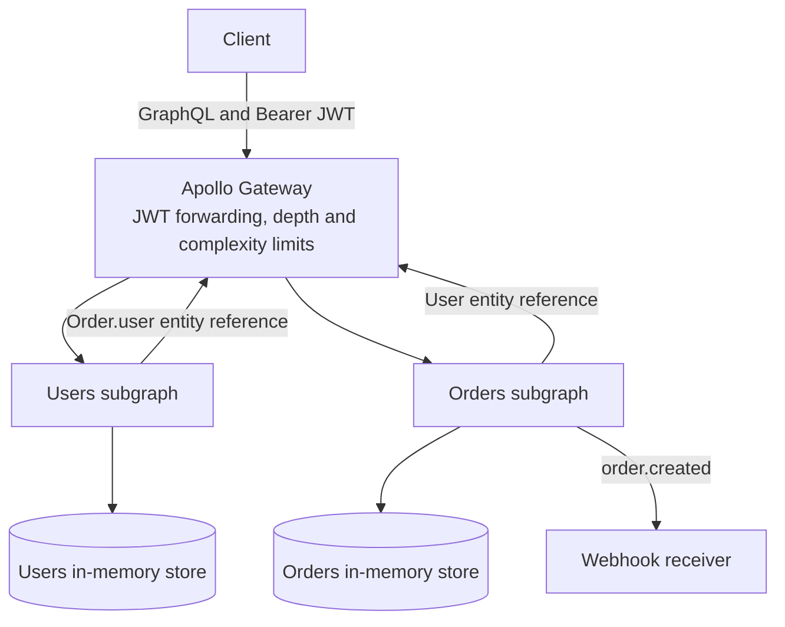

# GraphQL Federation Gateway

Apollo Federation 2 demo with two TypeScript subgraphs and a composing gateway. The users subgraph owns `User`. The orders subgraph owns `Order`, extends `User` with that person's orders, and sends an `order.created` webhook. The gateway checks a demo JWT, limits query depth and complexity, and joins the subgraphs into one API.

This is a portfolio demo for Arpan Bom's CV. It is not a production service. Data lives in memory, the JWT secret is a placeholder, and the token endpoint will sign a demo user with no password. Do not expose it beyond a local demo.

## Architecture



`Order.user` is resolved by the users subgraph. `User.orders` is resolved by the orders subgraph, which batches those loads with DataLoader. Apollo Gateway's JavaScript runtime does not proxy GraphQL subscriptions, so the cross-service event in this demo is a webhook.

## Run it

```bash
npm install
npm run dev
```

| Process | URL |
| --- | --- |
| Gateway | http://127.0.0.1:4100/graphql |
| Users subgraph | http://127.0.0.1:4101/graphql |
| Orders subgraph | http://127.0.0.1:4102/graphql |
| Demo token | POST http://127.0.0.1:4100/demo/token |
| Webhook log on the gateway | GET http://127.0.0.1:4100/demo/webhooks/orders |
| Delivery attempts on orders | GET http://127.0.0.1:4102/demo/webhook-deliveries |

Docker Compose runs the same three processes:

```bash
docker compose up --build
```

Seeded users:

| id | name | role |
| --- | --- | --- |
| `user_ada` | Ada Lovelace | ADMIN |
| `user_grace` | Grace Hopper | USER |
| `user_katherine` | Katherine Johnson | USER |

Ask the gateway for a token, then call the supergraph:

```bash
curl -s http://127.0.0.1:4100/demo/token \
  -H 'content-type: application/json' \
  -d '{"userId":"user_ada"}'

curl -s http://127.0.0.1:4100/graphql \
  -H 'content-type: application/json' \
  -H "authorization: Bearer $TOKEN" \
  -d '{"query":"query { users(first: 5) { edges { node { id name email orders(first: 5) { edges { node { id status totalCents } } } } } } }"}'
```

`name` is public. `email` needs any valid JWT. `role` needs an admin JWT. `User.orders` needs a JWT, and a non-admin caller can read only their own orders. `npm run token -- user_grace` prints a token for Grace without starting the servers.

Creating an order posts `order.created` to `WEBHOOK_URL` when that variable is set. `npm run dev` points it at the gateway's demo receiver. A failed delivery is stored on the orders service and does not roll back the order. The webhook token in `.env.example` is a demo placeholder, not a credential for an external system.

Query guards on the gateway:

- Depth limit: 8. Introspection fields are ignored.
- Complexity limit: 500. `users` and `orders` are charged by their `first` argument, capped at 20 rows.

## Test it

```bash
npm test
npm run compose
npm run lint
```

`npm test` runs Vitest. Resolver and DataLoader tests call the subgraph schemas directly. Integration tests compose the supergraph with `@apollo/composition` and execute queries in-process through Apollo Gateway, including entity references, DataLoader batching, auth directives, cursor pages, the webhook, and the depth and complexity guards. No browser, database, or external API is required.

`npm run compose` fails if the subgraphs do not compose. It uses `@apollo/composition`, the same library Rover uses. With the Rover CLI installed, this is the equivalent check:

```bash
rover supergraph compose --config supergraph.yaml
```

CI (`.github/workflows/ci.yml`) runs compose, lint, and tests. GitHub Actions are not executed from this workspace.

## Observability

This demo does not collect production metrics. Replace these placeholders if you instrument it later.

- Request latency (p95): _placeholder_
- Subgraph error rate: _placeholder_
- DataLoader batch size: _placeholder_

## License

MIT. See [LICENSE](LICENSE).
